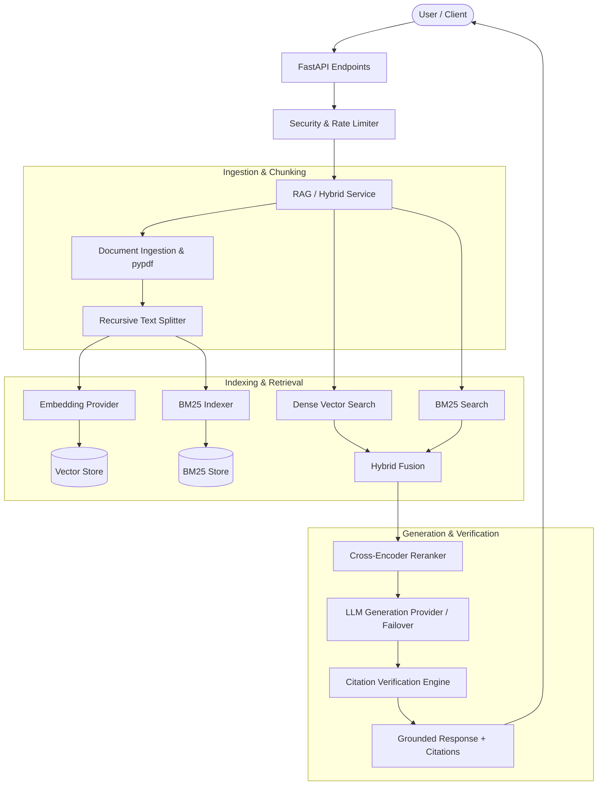

# RAGFlowX 🚀
### Production-Grade Hybrid RAG System with Dense Search, BM25, Reranking, Prompt Shielding, and Verified Citations

**RAGFlowX** is a modular, high-performance Retrieval-Augmented Generation (RAG) backend and API service built with FastAPI. It provides robust ingestion, page-level extraction, chunking, dense embeddings, vector storage, BM25 keyword search, hybrid fusion search, cross-encoder reranking, grounded LLM generation, claim-level citation verification, advanced security (rate limiting, secure authentication, prompt shielding, log redaction), and resilience patterns (circuit breakers, exponential backoff).

---

## Table of Contents
1. [Project Overview](#project-overview)
2. [Objectives](#objectives)
3. [Key Features](#key-features)
4. [Concepts and Technologies Used](#concepts-and-technologies-used)
5. [System Architecture](#system-architecture)
6. [Project Workflow](#project-workflow)
7. [Folder Structure](#folder-structure)
8. [Prerequisites](#prerequisites)
9. [Installation and Setup](#installation-and-setup)
10. [Configuration](#configuration)
11. [How to Run the Project](#how-to-run-the-project)
12. [API Documentation](#api-documentation)
13. [Example Usage](#example-usage)
14. [Testing and Validation](#testing-and-validation)
15. [Current Development Status](#current-development-status)
16. [Known Issues and Limitations](#known-issues-and-limitations)
17. [Future Improvements](#future-improvements)
18. [Contributing](#contributing)
19. [License](#license)

---

## 1. Project Overview
Enterprise-grade applications require high precision when answering user queries over proprietary documentation. Standard LLMs suffer from hallucinations and lack context awareness over private datasets. **RAGFlowX** solves this challenge by implementing an end-to-end Retrieval-Augmented Generation pipeline. It ingests documents, extracts text per page, chunks content hierarchically, embeds passages into dense vector spaces, indexes them alongside BM25 sparse indices, fuses search results using hybrid retrieval algorithms, reranks top results with cross-encoders, and generates strictly grounded answers supported by verifiable source citations and prompt injection protection.

## 2. Objectives
- Provide a robust, modular, production-ready RAG API backend.
- Support multi-format document ingestion (PDF, TXT, Markdown) with strict validation.
- Deliver high-recall hybrid search combining dense semantic similarity and sparse BM25 keyword matching.
- Ensure strict factual grounding through prompt templates, chain-of-thought reasoning, and claim verification.
- Implement production-grade security including hashed API key authentication, rate limiting, security headers, and prompt shielding.
- Maintain high code reliability backed by a comprehensive pytest test suite.

## 3. Key Features
- **Document Management**: Upload, inspect metadata, list, and delete documents with strict validation and page extraction.
- **Hierarchical Text Chunking**: Configurable recursive chunking preserving sentence boundaries and parent document lineage.
- **Dense & Sparse Retrieval**: Modular embedding providers (`SentenceTransformers`, `Mock`) paired with numpy cosine similarity vector search and `rank-bm25` keyword search.
- **Hybrid Search & Reranking**: Hybrid fusion search and cross-encoder reranking for maximum precision.
- **Grounded LLM Generation**: Support for Gemini, OpenAI, Mock, and Failover providers with chain-of-thought (`use_chain_of_thought`) reasoning.
- **Verified Citations**: Claim-level citation extraction and source attribution.
- **Advanced Security**: Hashed API key authentication with permission scopes, sliding-window rate limiting, request tracing (`X-Request-ID`), security headers, and prompt injection defense (Prompt Shield).
- **Resilience**: Circuit breakers and retry logic with exponential backoff and jitter.

## 4. Concepts and Technologies Used

| Technology / Concept | Purpose | Implementation Location |
| :--- | :--- | :--- |
| **FastAPI** | High-performance asynchronous web API framework | `backend/app/main.py`, `backend/app/api/` |
| **Pydantic / Pydantic Settings** | Type validation, serialization, and environment configuration | `backend/app/config.py`, `backend/app/schemas/` |
| **Sentence-Transformers** | Dense embedding generation & cross-encoder reranking | `backend/app/services/embeddings/`, `backend/app/services/reranking/` |
| **Rank-BM25** | Sparse keyword search | `backend/app/services/retrieval/bm25.py` |
| **NumPy** | High-performance vector operations & cosine similarity | `backend/app/database/vector_store.py` |
| **PyPDF** | Page-by-page PDF text extraction | `backend/app/services/ingestion/` |
| **Security & Rate Limiter** | Hashed API keys, sliding window rate limit, prompt shielding | `backend/app/core/security.py`, `backend/app/core/rate_limiter.py`, `backend/app/core/prompt_shield.py` |
| **Resilience Manager** | Circuit breaker and backoff retry logic | `backend/app/core/resilience.py` |

---

## 5. System Architecture

The high-level architecture separates concerns into ingestion, chunking, indexing, retrieval, fusion, reranking, and secure LLM generation:



---

## 6. Project Workflow
1. **Upload & Ingestion**: Client sends a document (`POST /api/v1/documents/upload`). The service validates file type, size, and sanitizes input, saving raw files to `uploads/`.
2. **Chunking**: Document text is extracted page-by-page and split recursively into overlapping chunks (`POST /api/v1/chunks/process/{document_id}`).
3. **Embedding & Indexing**: Chunks are embedded via SentenceTransformers and indexed into the vector database (`POST /api/v1/vector-store/index/{document_id}`) and BM25 store.
4. **Hybrid Search & Reranking**: Queries undergo dense and sparse retrieval, followed by hybrid score fusion and cross-encoder reranking.
5. **LLM Generation**: Retrieved contexts and user queries are formatted into a strict grounded prompt passed to Gemini, OpenAI, or Mock LLM providers.
6. **Verification & Response**: Generated answers are verified against source chunks to produce citations and confidence scores.

---

## 7. Folder Structure

```text
.
├── backend/
│   └── app/
│       ├── main.py              # FastAPI application entrypoint & middleware
│       ├── config.py            # Environment settings & validation
│       ├── api/                 # API routers & endpoint definitions
│       │   ├── router.py
│       │   └── routes/          # Health, documents, chunks, embeddings, vector_store, bm25, hybrid, rerank, rag, pipeline, sessions, api_keys
│       ├── core/                # Core engines (security, rate_limiter, prompt_shield, resilience, redaction)
│       ├── services/            # Modular business logic (ingestion, chunking, embeddings, retrieval, reranking, generation, citations)
│       ├── models/              # Domain data models
│       ├── schemas/             # Pydantic request/response schemas
│       ├── database/            # Persistent storage stores (document, chunk, vector)
│       └── utils/               # Helper utilities & logging
├── data/                        # Persistent JSON storage (git-ignored)
├── uploads/                     # Uploaded raw files (git-ignored)
├── tests/                       # Comprehensive pytest test suite
├── evaluation/                  # Evaluation scripts & datasets
├── run.py                       # Server entrypoint script
├── pytest.ini                   # Pytest configuration
├── .env.example                 # Environment template
├── requirements.txt             # Python package dependencies
└── README.md                    # Project documentation
```

---

## 8. Prerequisites
- **Python**: Version 3.10 or higher.
- **Pip**: Python package manager.
- **Optional**: Gemini API key or OpenAI API key for live LLM generation.

---

## 9. Installation and Setup

```bash
# 1. Clone the repository
git clone https://github.com/akshay9128/RAGFlowX.git
cd RAGFlowX

# 2. Create and activate virtual environment (Windows PowerShell)
python -m venv venv
.\venv\Scripts\Activate.ps1

# (Linux / macOS)
# python3 -m venv venv
# source venv/bin/activate

# 3. Install dependencies
pip install -r requirements.txt
```

---

## 10. Configuration
Copy `.env.example` to `.env` and configure settings:
```bash
cp .env.example .env
```
Key variables:
- `APP_NAME`: Application title.
- `DEBUG`: Enable debug mode.
- `LLM_PROVIDER`: `gemini`, `openai`, or `mock`.
- `AUTH_ENABLED`: Enable API key authentication (`True`/`False`).
- `RATE_LIMIT_ENABLED`: Enable sliding-window rate limiting (`True`/`False`).

---

## 11. How to Run the Project

Start the development server using `run.py`:
```bash
python run.py
```
- API Root: `http://localhost:8000`
- Interactive Swagger Docs: `http://localhost:8000/docs`
- Interactive ReDoc: `http://localhost:8000/redoc`

---

## 12. API Documentation

| HTTP Method | Endpoint Path | Purpose | Auth Required |
| :--- | :--- | :--- | :--- |
| `GET` | `/health` | Application health and status check | No |
| `POST` | `/api/v1/documents/upload` | Upload and ingest PDF/TXT/MD document | Yes (Scopes) |
| `GET` | `/api/v1/documents/` | List all ingested documents | Yes |
| `POST` | `/api/v1/chunks/process/{id}` | Process document into text chunks | Yes |
| `POST` | `/api/v1/vector-store/index/{id}` | Index chunks into vector store | Yes |
| `POST` | `/api/v1/vector-store/search` | Perform dense vector similarity search | Yes |
| `POST` | `/api/v1/bm25/search` | Perform BM25 sparse keyword search | Yes |
| `POST` | `/api/v1/hybrid/search` | Execute hybrid search (dense + sparse) | Yes |
| `POST` | `/api/v1/rerank/cross-encoder` | Rerank retrieved passages | Yes |
| `POST` | `/api/v1/rag/query` | Execute RAG pipeline query | Yes |
| `GET` | `/api/v1/rag/info` | Inspect active RAG configuration & models | Yes |

---

## 13. Example Usage

Example query request via `curl`:
```bash
curl -X POST "http://localhost:8000/api/v1/rag/query" \
     -H "Content-Type: application/json" \
     -H "X-API-Key: valid-bootstrap-admin-key" \
     -d '{"query": "What are the core features of RAGFlowX?", "top_k": 3}'
```

---

## 14. Testing and Validation
Run the full test suite with pytest:
```bash
python -m pytest
```
All 137 unit and integration test cases covering security, auth, vector store, hybrid search, RAG, and provider signatures execute and pass successfully.

---

## 15. Current Development Status
- **Implemented**: Core FastAPI architecture, document ingestion, page extraction, chunking, dense embeddings, vector database, BM25 search, hybrid retrieval, cross-encoder reranking, LLM generation (Gemini, OpenAI, Mock, Failover), citation verification, sliding-window rate limiting, secure API key authentication, prompt shielding, and circuit breakers.
- **Partially Implemented**: Antivirus file scanning integration (mock/stub).
- **Planned / Future Work**: Production distributed vector database integration (e.g. Pinecone/Milvus), streaming LLM responses.

---

## 16. Known Issues and Limitations
- Local storage persistence (`data/` and `uploads/`) is designed for single-instance development and testing.
- Live API calls require valid `GEMINI_API_KEY` or `OPENAI_API_KEY` environment variables.

---

## 17. Future Improvements
- Add WebSocket support for real-time streaming RAG responses.
- Integrate distributed vector database connectors.

---

## 18. Contributing
1. Fork the repository.
2. Create a feature branch (`git checkout -b feature/amazing-feature`).
3. Commit your changes (`git commit -m 'Add amazing feature'`).
4. Push to the branch (`git push origin feature/amazing-feature`).
5. Open a Pull Request.

---

## 19. License
This project is proprietary and confidential.
